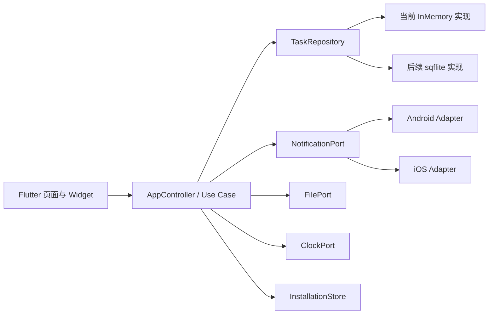

# DDL 生存指南接口文档

> 文档版本：1.3
> 更新时间：2026-10-05
> 当前实现阶段：SQLite 提醒计划与 Android/iOS 本地通知适配（待真机验收）
> 适用平台：Android、iOS

## 1. 文档范围

当前产品是无账号、无业务后端、无云数据库的本地应用，因此本项目暂时没有 HTTP REST API。本文件约定 Flutter 页面层与本地数据、通知、文件和时间能力之间的应用内接口。

接口目标：

- 页面不直接拼接 SQL，不直接调用 Android 或 iOS API。
- Widget 测试可继续注入内存数据源，Android/iOS 生产入口使用 `sqflite` Repository。
- Android/iOS 通知实现可以独立替换，不影响任务页面。
- 所有写操作返回最终领域对象，页面不猜测持久化结果。
- 错误以稳定错误码表达，不把插件异常直接显示给用户。

## 2. 分层与依赖方向



依赖只能从页面层指向接口，平台 Adapter 不允许反向依赖页面 Widget。

## 3. 通用约定

### 3.1 异步与返回值

- 所有 I/O 接口返回 `Future<T>`。
- 创建和更新返回持久化后的完整 `TaskItem`。
- 查询列表返回不可修改集合或集合副本。
- 删除成功返回 `void`；目标不存在返回 `TASK_NOT_FOUND`，不静默成功。

### 3.2 时间

- 领域层统一使用 `DateTime`，持久化为 UTC 毫秒时间戳。
- 页面展示时转换为设备当前时区。
- 通知 Adapter 接收已经确定的触发时间，不自行修改业务提前量。
- 测试不得直接依赖 `DateTime.now()`，正式领域 Use Case 使用 `ClockPort`。

### 3.3 标识符

- 任务 ID 是跨导出、导入保持稳定的字符串。
- 通知 ID 是平台 Adapter 管理的字符串；Android Adapter 可在内部映射为整数。
- 页面不得根据 ID 格式推断业务含义。

### 3.4 错误模型

正式实现统一映射为 `AppFailure`：

- `TASK_NOT_FOUND`：任务不存在或已经删除。
- `REMINDER_NOT_FOUND`：提醒记录不存在或已经删除。
- `VALIDATION_FAILED`：字段、状态流转或导入内容不合法。
- `DATABASE_UNAVAILABLE`：数据库无法打开或连接失效。
- `MIGRATION_FAILED`：Schema 升级失败并已回滚。
- `STORAGE_FULL`：设备存储空间不足。
- `NOTIFICATION_PERMISSION_DENIED`：用户未授权通知。
- `EXACT_ALARM_PERMISSION_DENIED`：Android 精确提醒权限未授权。
- `NOTIFICATION_SCHEDULE_FAILED`：系统通知排程失败。
- `FILE_PICK_CANCELLED`：用户主动取消文件选择，不展示为错误。
- `IMPORT_VERSION_UNSUPPORTED`：导入文件版本不支持。
- `IMPORT_CORRUPTED`：导入文件损坏或校验失败。

错误对象至少包含 `code`、面向开发的 `message`、可选 `cause`；日志不得附带任务标题和备注。

## 4. Task 领域模型

当前代码位置：`lib/src/domain/task.dart`。

`TaskItem` 字段：

- `id: String`：稳定任务标识。
- `title: String`：1 至 80 个字符。
- `dueAt: DateTime`：截止时间，用户输入精确到分钟。
- `category: TaskCategory`：`study`、`work`、`life`、`fun`。
- `isImportant: bool`：用户设置的重要度。
- `estimatedMinutes: int`：预计耗时，必须大于 0。
- `status: TaskStatus`：任务状态。
- `createdAt: DateTime`：创建时间。
- `notes: String`：可选备注，最多 1000 个字符。
- `completedAt: DateTime?`：完成或逾期完成时间。

`TaskStatus`：

- `active`：进行中。
- `completed`：按期或正常完成。
- `overdueReview`：逾期，等待忏悔录处理。
- `missed`：确认未完成。
- `completedLate`：完成了但未及时打勾。
- `archived`：归档，不参与压力计算。

合法主状态流转：

- `active -> completed | overdueReview | archived`。
- `overdueReview -> missed | completedLate`。
- 已终态任务不得直接回到 `active`；后续“重新立约”创建新任务。
- 当 `now >= dueAt` 时，未完成任务先进入 `overdueReview`；此时提交普通完成也按逾期待处理处理，不得直接记为 `completed`。

## 5. TaskRepository

当前接口位置：`lib/src/domain/ports.dart`。

```dart
abstract interface class TaskRepository {
  Future<List<TaskItem>> listTasks();
  Future<int> reconcileOverdue(DateTime asOf);
  Future<TaskItem?> getTask(String id);
  Future<TaskItem> createTask(TaskDraft draft);
  Future<TaskItem> updateTask(TaskItem task);
  Future<TaskItem> transitionTask(String id, TaskStatus target);
  Future<void> deleteTask(String id);
  Future<Map<TaskCategory, double>> missedRatesByCategory();
  Future<bool> hasMeaningfulHistory(String id);
}
```

`reconcileOverdue(asOf)` 在单一事务内把 `dueAt <= asOf` 的未完成任务转为 `overdueReview` 并各写入一条 `TASK_OVERDUE` 事件；返回转换数量。重复调用不新增事件或版本变化，已完成/已结案/已归档任务不受影响。

### 5.1 `listTasks`

- 返回当前设备中全部未物理删除的任务。
- 排序由调用方明确指定；Repository 不暗含页面排序。
- 后续 SQLite 实现增加查询对象 `TaskQuery`，支持状态、时间窗口、分类、分页和风险候选集过滤。

### 5.2 `getTask`

- 找到时返回完整领域对象。
- 不存在时返回 `null`，适用于详情路由容错。

### 5.3 `createTask`

- 验证标题、预计耗时和截止时间格式。
- 使用事务同时写入任务和 `task_events` 创建事件。
- 数据库提交后，由 Use Case 调用 `NotificationPort` 更新提醒。
- 重复点击由页面提交锁与 Use Case 幂等键共同防护。

### 5.4 `updateTask`

- 使用乐观版本号防止旧页面覆盖新数据；SQLite 阶段给 `TaskItem` 增加 `version`。
- 截止时间、重要度或预计耗时变化后，Use Case 必须重新计算风险和通知。
- 首轮只允许编辑进行中任务；逾期待结案、已完成、已错过和已归档任务不可编辑，避免通过修改截止时间绕过结案。编辑全部用户输入字段，并记录 `TASK_UPDATED`。

### 5.5 `transitionTask`

- Repository 验证状态流转是否合法。
- 任务状态和 `task_events` 必须在同一事务中写入。
- 重复提交相同终态不得生成重复事件。

### 5.6 `deleteTask`

- MVP 允许物理删除无历史任务。
- “有历史”指除 `TASK_CREATED` 外存在 `TASK_UPDATED`、逾期或结案等事件；仅创建事件的进行中任务可物理删除。
- `hasMeaningfulHistory` 供 Use Case 选择归档或删除；已结案任务即使缺少事件也保守归档，`overdueReview` 必须先结案。归档任务不可再次删除；二次确认文案应告知实际结果。
- 删除成功后必须取消对应平台通知。

### 5.7 `missedRatesByCategory`

- 按当前仍存在的同类任务的结案事件计算 `TASK_MISSED / (TASK_MISSED + TASK_COMPLETED + TASK_COMPLETED_LATE)`；归档保留事件并参与统计，未结案任务不参与。无结案记录时返回 0。
- 风险分展示和排序使用相同的纯 Dart 规则；SQLite 的风险快照是可再生缓存，不作为业务真值。

## 6. NotificationPort

```dart
abstract interface class NotificationPort {
  Future<NotificationCapabilities> inspect();
  Future<bool> requestPermission();
  Future<bool> requestExactPermission();
  Future<bool> openSettings();
  Future<String> deviceTimezone();
  Future<Set<int>> pendingIds();
  Future<void> schedule({
    required int id,
    required DateTime fireAt,
    required ReminderChannel channel,
    required String taskId,
    required bool exact,
  });
  Future<void> cancel(int id);
  Stream<String> get selectedTaskIds;
  String? takeInitialTaskId();
}
```

`NotificationCapabilities` 提供通知授权、精确排程能力、是否需要特殊权限和平台待处理数量上限。`ReminderRecord.id` 是稳定业务 ID；`platformNotificationIdFor` 将其转换为正整数平台 ID，并写回 SQLite 的 `platform_notification_id`。

行为约定：

- `ReminderCoordinator` 先把任务与偏好转换为 SQLite 期望记录；`PlatformReminderCoordinator` 再对比平台待处理 ID，取消过期/不再需要的通知并补排未来记录。
- DDL 定时提醒的目标时间精确到分钟；Android 有精确提醒权限时使用精确排程，权限缺失时的非精确降级必须明确标示，不能承诺指定分钟送达。
- 已完成、未完成结案、归档和删除任务的计划必须全部取消。
- 启动、恢复前台、任务与偏好变化时调用协调；设备时区通过插件识别并保存为 IANA 标识，变化时强制重新排程。Android 重启由插件广播接收器恢复。后台系统时间/时区广播尚未单独接入，应用下次启动或恢复前台时修复。
- 通知排程不属于 SQLite 事务；数据库提交成功但排程失败时记录 `SCHEDULE_FAILED`，下次启动重试。
- 冷启动不主动请求权限；用户开启提醒或点击授权入口时才请求。拒绝后记录 `NOTIFICATION_PERMISSION_DENIED`，页面展示能力降级和系统设置入口。通知点按 payload 为任务 ID，不含标题/备注。

Android Adapter：

- 管理 `ddl_critical` 与 `ddl_normal` NotificationChannel。
- 检查 `POST_NOTIFICATIONS` 与精确提醒权限。
- 支持非精确提醒降级、降级状态提示、开机恢复和 OPPO/vivo 后台设置引导。

iOS Adapter：

- 使用 UserNotifications 权限与系统排程。
- 只保留触发时间最近的最多 60 个通知，为系统 64 个待处理通知限制预留空间。
- 应用启动、恢复前台和任务变化时滚动补充排程窗口。

## 6.1 本地设置、资料与提醒记录 Repository（2026-10-04 批次）

- `PreferenceRepository.getOrCreate()` 返回持久化的单例配置；首次为空时事务内写入默认值。`save(value)` 验证通知开关、文案强度、免打扰分钟、提醒提前分钟列表、紧急阈值、缓冲分钟和 IANA 时区标识，返回完整配置。默认免打扰 23:00—07:30，提前量 1440/180 分钟，紧急阈值 60 分钟，缓冲 60 分钟；接入平台通知后会在启动/恢复前台同步设备 IANA 时区。
- `ProfileRepository.getOrCreate()` 和 `save(value)` 持久化昵称、签名及可选头像 URI；编辑资料只写本地 SQLite，不引入账号。
- `ReminderRepository.listForTask(taskId)`、`listOutstanding()`、`replaceForTask(taskId, records)`、`syncPlanForTask(taskId, desired)`、`updateStatus(id, status, platformNotificationId?, lastErrorCode?)`、`cancelForTask(taskId)` 仅维护 SQLite 排程记录。`syncPlanForTask` 在事务中增补新目标、取消不再需要的待处理记录，保留已触发/取消及排程失败的历史；同一目标重复调用返回 0 变更。系统通知由独立平台协调器在事务提交后处理，不把 `PENDING` 记录误称为已排程或送达。
- 这些接口在 Web 预览使用内存实现，Android/iOS 生产入口注入 SQLite 实现；页面不得直接读写数据库。

## 6.2 提醒计划协调（2026-10-04 批次）

- `ReminderPlanner.plan(task, preferences, now, allTasks, missedRate)` 只处理进行中且未到期、通知偏好开启的任务。默认按截止前 1440/180 分钟生成目标；预计耗时超过 180 分钟时额外生成“预计耗时 + 缓冲分钟”的提前目标；在偏好定义的紧急阈值（默认截止前一小时）的投影风险为“极高”时增加紧急目标。用户修改默认提前量后使用其保存的分钟列表。
- 候选时间按设备本地分钟处理；落在免打扰时段时顺延至该时段结束，若顺延后不早于截止时间则舍弃；过去目标舍弃，同一分钟去重并优先保留紧急渠道。相同任务版本、目标分钟和渠道生成稳定业务 ID。
- `ReminderCoordinator.reconcile(tasks, preferences, now, missedRates)` 对当前任务投影执行增量对账。创建/编辑/结案/归档/删除、偏好变更、冷启动、恢复前台及前台定时复核均会触发；终态或关闭通知时取消未完成计划。SQLite 记录保留历史状态，数据库重开后重复对账不产生新行。
- 协调异常不阻断任务页面；`AppController.reminderSyncErrorCode` 在设置页提示稳定错误码，下次启动、恢复前台或任务变更时重试。已存在的 `SCHEDULE_FAILED` 记录不会被无差异对账覆盖，平台 Adapter 可重试。
- 2026-10-05 已接入 `FlutterNotificationPort`：Android/iOS 本地排程、平台差异修复、权限检查与用户主动申请、精确权限缺失时非精确降级、点击进入任务详情、设备 IANA 时区识别及前台恢复协调。自动化测试和 Android Debug APK 构建通过；vivo V2362A 的权限界面、精确送达和点按已做对照回归，原智能控制后台耗电模式未送达、临时允许后台高耗电后送达。手机已恢复原设置；OPPO/iPhone 和系统重启仍未真机验收。

## 7. FilePort

```dart
abstract interface class FilePort {
  Future<String?> exportJson(String suggestedName, String content);
  Future<String?> pickJson();
}
```

- Android 使用系统文件选择器，不申请宽泛存储权限。
- iOS 使用 Files 或 Share Sheet。
- 用户取消选择返回 `null`，不记录错误日志。
- 导入文件先完整校验，再在单一事务中覆盖；失败时保留原数据。

## 8. ClockPort

```dart
abstract interface class ClockPort {
  DateTime now();
}
```

- 风险算法、逾期流转、倒计时和提醒计划均从 Clock 获取当前时间。
- 单元测试注入固定 Clock，覆盖跨日、时区切换、时间回拨与夏令时。

## 9. InstallationStore

```dart
abstract interface class InstallationStore {
  Future<DateTime> getOrCreateFirstLaunchDate();
}
```

- 首次启动时保存用户本地日期，并从该自然日开始显示“生存第 1 天”。
- 后续启动读取同一日期，使用本地自然日差值加一计算累计天数。
- 当前 `SharedPreferencesInstallationStore` 已覆盖 Android、iOS 与 Web；未来接入 SQLite 时可以迁移实现，但接口保持不变。
- 日期异常或晚于当前日期时，页面至少显示第 1 天，不出现零或负数。

## 10. 前端控制器交互

当前 `AppController` 提供页面可调用的 Use Case 入口：

- `load()`：先协调逾期，再加载任务并刷新所有派生视图。
- `refreshOverdue()`：应用回到前台或前台计时到点时协调逾期并刷新投影。
- `addTask(draft)`：创建任务。
- `completeTask(id)`：未到期进入 `completed`；若已到期则进入 `overdueReview` 并返回需去忏悔录处理的结果。
- `completeLate(id)`：从忏悔录进入 `completedLate`。
- `markMissed(id)`：从忏悔录进入 `missed`。
- `archiveTask(id)`：归档。
- `deleteTask(id)`：删除。
- `setNavigationIndex(index)`：切换主导航。
- `setQuadrant(quadrant)`、`setTodoScope(scope)`：更新待办筛选。
- `setNotificationsEnabled(value)`、`setCopyTone(tone)`、`setQuietHours(start, end)`、`setDefaultReminderOffsets(offsets)`、`saveProfile(nickname, motto)`：验证并持久化本地设置或资料，成功后更新页面状态。

Android/iOS 生产环境已注入 SQLite `PreferenceRepository`、`ProfileRepository`、`ReminderRepository` 与 `FlutterNotificationPort`；Web 预览及 Widget 测试使用内存实现。通知开关会生成/取消本机计划，并在平台授权后同步本地通知；非精确降级不承诺指定分钟送达。

## 11. JSON 导出协议

首版导出顶层结构：

```json
{
  "formatVersion": 1,
  "exportedAt": "2026-09-18T10:00:00.000Z",
  "appVersion": "1.0.0",
  "tasks": [],
  "taskEvents": [],
  "categories": [],
  "preferences": {}
}
```

约束：

- 时间使用 ISO 8601 UTC 字符串。
- 枚举使用本文档约定的稳定英文值。
- 不导出平台通知 ID、数据库文件路径、密钥或诊断日志。
- 未知字段允许忽略；未知枚举和更高 `formatVersion` 必须拒绝导入。
- 导入完成后重新计算风险和平台通知，不复用原设备排程。

## 12. 当前 Mock 与后续实现映射

- `InMemoryTaskRepository`：已实现，默认数据为空，供页面交互和 Widget 测试使用。
- `SqliteTaskRepository`：已实现，覆盖任务 CRUD、乐观版本校验、状态流转、事务事件和稳定错误码。
- `AppDatabase`：已实现数据库 v1 建库、默认分类、索引、外键和前向迁移入口。
- `SharedPreferencesInstallationStore`：已实现，持久保存首次启动日期。
- `InMemoryInstallationStore`：已实现，供单元测试和 Widget 测试使用。
- `NotificationPort`：契约及 Android/iOS 共用插件 Adapter 已实现，真机送达与系统限制仍待验收。
- `FilePort`：契约已定义，Android/iOS Adapter 未实现。
- `ClockPort`：已提供 `SystemClock`，Controller 与 Repository 均支持测试时注入。

页面层不得因为 Mock 尚未替换而调用 `sqflite` 或通知插件。替换完成的验收标准是：Widget 测试无需修改，只替换依赖注入对象。
