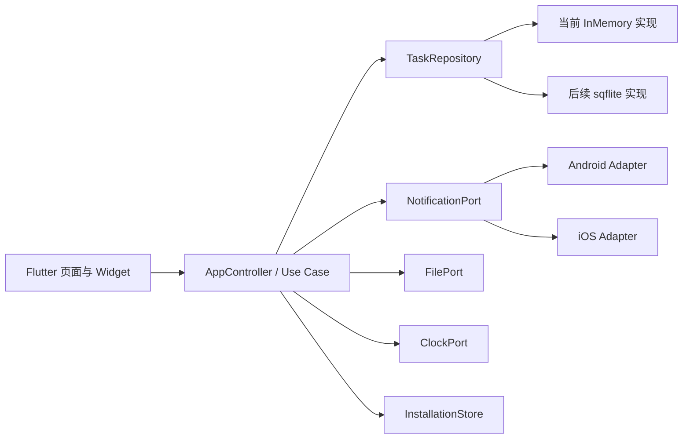

# DDL 生存指南接口文档

> 文档版本：1.2
> 更新时间：2026-09-18
> 当前实现阶段：Flutter 前端与 SQLite 任务数据层
> 适用平台：Android、iOS

## 1. 文档范围

当前产品是无账号、无业务后端、无云数据库的本地应用，因此本项目暂时没有 HTTP REST API。本文件约定 Flutter 页面层与本地数据、通知、文件和时间能力之间的应用内接口。

接口目标：

- 页面不直接拼接 SQL，不直接调用 Android 或 iOS API。
- Widget 测试可继续注入内存数据源，Android/iOS 生产入口使用 `sqflite` Repository。
- Android/iOS 通知实现可以独立替换，不影响任务页面。
- 所有写操作返回最终领域对象，页面不猜测持久化结果。
- 错误以稳定错误码表达，不把插件异常直接显示给用户。

## 2. 分层与依赖方向



依赖只能从页面层指向接口，平台 Adapter 不允许反向依赖页面 Widget。

## 3. 通用约定

### 3.1 异步与返回值

- 所有 I/O 接口返回 `Future<T>`。
- 创建和更新返回持久化后的完整 `TaskItem`。
- 查询列表返回不可修改集合或集合副本。
- 删除成功返回 `void`；目标不存在返回 `TASK_NOT_FOUND`，不静默成功。

### 3.2 时间

- 领域层统一使用 `DateTime`，持久化为 UTC 毫秒时间戳。
- 页面展示时转换为设备当前时区。
- 通知 Adapter 接收已经确定的触发时间，不自行修改业务提前量。
- 测试不得直接依赖 `DateTime.now()`，正式领域 Use Case 使用 `ClockPort`。

### 3.3 标识符

- 任务 ID 是跨导出、导入保持稳定的字符串。
- 通知 ID 是平台 Adapter 管理的字符串；Android Adapter 可在内部映射为整数。
- 页面不得根据 ID 格式推断业务含义。

### 3.4 错误模型

正式实现统一映射为 `AppFailure`：

- `TASK_NOT_FOUND`：任务不存在或已经删除。
- `VALIDATION_FAILED`：字段、状态流转或导入内容不合法。
- `DATABASE_UNAVAILABLE`：数据库无法打开或连接失效。
- `MIGRATION_FAILED`：Schema 升级失败并已回滚。
- `STORAGE_FULL`：设备存储空间不足。
- `NOTIFICATION_PERMISSION_DENIED`：用户未授权通知。
- `EXACT_ALARM_PERMISSION_DENIED`：Android 精确提醒权限未授权。
- `NOTIFICATION_SCHEDULE_FAILED`：系统通知排程失败。
- `FILE_PICK_CANCELLED`：用户主动取消文件选择，不展示为错误。
- `IMPORT_VERSION_UNSUPPORTED`：导入文件版本不支持。
- `IMPORT_CORRUPTED`：导入文件损坏或校验失败。

错误对象至少包含 `code`、面向开发的 `message`、可选 `cause`；日志不得附带任务标题和备注。

## 4. Task 领域模型

当前代码位置：`lib/src/domain/task.dart`。

`TaskItem` 字段：

- `id: String`：稳定任务标识。
- `title: String`：1 至 60 个字符。
- `dueAt: DateTime`：截止时间。
- `category: TaskCategory`：`study`、`work`、`life`、`fun`。
- `isImportant: bool`：用户设置的重要度。
- `estimatedMinutes: int`：预计耗时，必须大于 0。
- `status: TaskStatus`：任务状态。
- `createdAt: DateTime`：创建时间。
- `notes: String`：可选备注，最多 300 个字符。
- `completedAt: DateTime?`：完成或逾期完成时间。

`TaskStatus`：

- `active`：进行中。
- `completed`：按期或正常完成。
- `overdueReview`：逾期，等待忏悔录处理。
- `missed`：确认未完成。
- `completedLate`：完成了但未及时打勾。
- `archived`：归档，不参与压力计算。

合法主状态流转：

- `active -> completed | overdueReview | archived`。
- `overdueReview -> missed | completedLate`。
- 已终态任务不得直接回到 `active`；后续“重新立约”创建新任务。

## 5. TaskRepository

当前接口位置：`lib/src/domain/ports.dart`。

```dart
abstract interface class TaskRepository {
  Future<List<TaskItem>> listTasks();
  Future<TaskItem?> getTask(String id);
  Future<TaskItem> createTask(TaskDraft draft);
  Future<TaskItem> updateTask(TaskItem task);
  Future<TaskItem> transitionTask(String id, TaskStatus target);
  Future<void> deleteTask(String id);
}
```

### 5.1 `listTasks`

- 返回当前设备中全部未物理删除的任务。
- 排序由调用方明确指定；Repository 不暗含页面排序。
- 后续 SQLite 实现增加查询对象 `TaskQuery`，支持状态、时间窗口、分类、分页和风险候选集过滤。

### 5.2 `getTask`

- 找到时返回完整领域对象。
- 不存在时返回 `null`，适用于详情路由容错。

### 5.3 `createTask`

- 验证标题、预计耗时和截止时间格式。
- 使用事务同时写入任务和 `task_events` 创建事件。
- 数据库提交后，由 Use Case 调用 `NotificationPort` 更新提醒。
- 重复点击由页面提交锁与 Use Case 幂等键共同防护。

### 5.4 `updateTask`

- 使用乐观版本号防止旧页面覆盖新数据；SQLite 阶段给 `TaskItem` 增加 `version`。
- 截止时间、重要度或预计耗时变化后，Use Case 必须重新计算风险和通知。

### 5.5 `transitionTask`

- Repository 验证状态流转是否合法。
- 任务状态和 `task_events` 必须在同一事务中写入。
- 重复提交相同终态不得生成重复事件。

### 5.6 `deleteTask`

- MVP 允许物理删除无历史任务。
- 已有历史事件的任务优先归档；正式 SQLite 实现由 Use Case 决定调用 `archive` 或 `delete`。
- 删除成功后必须取消对应平台通知。

## 6. NotificationPort

```dart
abstract interface class NotificationPort {
  Future<bool> requestPermission();
  Future<void> replaceTaskReminders(String taskId, List<ReminderPlan> plans);
  Future<void> cancelTaskReminders(String taskId);
  Future<void> reconcile(List<ReminderPlan> expected);
}
```

`ReminderPlan` 字段：

- `taskId`：所属任务。
- `notificationId`：稳定业务通知 ID。
- `fireAt`：触发时间。
- `title`：通知标题，不包含备注。
- `body`：通知正文，遵守锁屏隐私设置。

行为约定：

- `replaceTaskReminders` 是替换语义：先取消该任务旧计划，再排程新计划。
- 已完成、未完成结案、归档和删除任务的计划必须全部取消。
- `reconcile` 以 SQLite 中的 Reminder 为期望状态，以系统待处理通知为实际状态，修复差异。
- 通知排程不属于 SQLite 事务；数据库提交成功但排程失败时记录 `SCHEDULE_FAILED`，下次启动重试。
- 权限拒绝不是崩溃条件，页面显示能力降级和系统设置入口。

Android Adapter：

- 管理 `ddl_critical` 与 `ddl_normal` NotificationChannel。
- 检查 `POST_NOTIFICATIONS` 与精确提醒权限。
- 支持非精确提醒降级、开机恢复和 OPPO/vivo 后台设置引导。

iOS Adapter：

- 使用 UserNotifications 权限与系统排程。
- 只保留触发时间最近的最多 60 个通知，为系统 64 个待处理通知限制预留空间。
- 应用启动、恢复前台和任务变化时滚动补充排程窗口。

## 7. FilePort

```dart
abstract interface class FilePort {
  Future<String?> exportJson(String suggestedName, String content);
  Future<String?> pickJson();
}
```

- Android 使用系统文件选择器，不申请宽泛存储权限。
- iOS 使用 Files 或 Share Sheet。
- 用户取消选择返回 `null`，不记录错误日志。
- 导入文件先完整校验，再在单一事务中覆盖；失败时保留原数据。

## 8. ClockPort

```dart
abstract interface class ClockPort {
  DateTime now();
}
```

- 风险算法、逾期流转、倒计时和提醒计划均从 Clock 获取当前时间。
- 单元测试注入固定 Clock，覆盖跨日、时区切换、时间回拨与夏令时。

## 9. InstallationStore

```dart
abstract interface class InstallationStore {
  Future<DateTime> getOrCreateFirstLaunchDate();
}
```

- 首次启动时保存用户本地日期，并从该自然日开始显示“生存第 1 天”。
- 后续启动读取同一日期，使用本地自然日差值加一计算累计天数。
- 当前 `SharedPreferencesInstallationStore` 已覆盖 Android、iOS 与 Web；未来接入 SQLite 时可以迁移实现，但接口保持不变。
- 日期异常或晚于当前日期时，页面至少显示第 1 天，不出现零或负数。

## 10. 前端控制器交互

当前 `AppController` 提供页面可调用的 Use Case 入口：

- `load()`：加载任务并刷新所有派生视图。
- `addTask(draft)`：创建任务。
- `completeTask(id)`：进入 `completed`。
- `completeLate(id)`：从忏悔录进入 `completedLate`。
- `markMissed(id)`：从忏悔录进入 `missed`。
- `archiveTask(id)`：归档。
- `deleteTask(id)`：删除。
- `setNavigationIndex(index)`：切换主导航。
- `setQuadrant(quadrant)`、`setTodoScope(scope)`：更新待办筛选。
- `setNotificationsEnabled(value)`、`setCopyTone(tone)`：更新当前设置页面状态。

当前设置项仍为前端内存状态；接入 SQLite 时新增 `PreferenceRepository`，页面调用方式保持不变。

## 11. JSON 导出协议

首版导出顶层结构：

```json
{
  "formatVersion": 1,
  "exportedAt": "2026-09-18T10:00:00.000Z",
  "appVersion": "1.0.0",
  "tasks": [],
  "taskEvents": [],
  "categories": [],
  "preferences": {}
}
```

约束：

- 时间使用 ISO 8601 UTC 字符串。
- 枚举使用本文档约定的稳定英文值。
- 不导出平台通知 ID、数据库文件路径、密钥或诊断日志。
- 未知字段允许忽略；未知枚举和更高 `formatVersion` 必须拒绝导入。
- 导入完成后重新计算风险和平台通知，不复用原设备排程。

## 12. 当前 Mock 与后续实现映射

- `InMemoryTaskRepository`：已实现，默认数据为空，供页面交互和 Widget 测试使用。
- `SqliteTaskRepository`：已实现，覆盖任务 CRUD、乐观版本校验、状态流转、事务事件和稳定错误码。
- `AppDatabase`：已实现数据库 v1 建库、默认分类、索引、外键和前向迁移入口。
- `SharedPreferencesInstallationStore`：已实现，持久保存首次启动日期。
- `InMemoryInstallationStore`：已实现，供单元测试和 Widget 测试使用。
- `NotificationPort`：契约已定义，Android/iOS Adapter 未实现。
- `FilePort`：契约已定义，Android/iOS Adapter 未实现。
- `ClockPort`：已提供 `SystemClock`，Controller 与 Repository 均支持测试时注入。

页面层不得因为 Mock 尚未替换而调用 `sqflite` 或通知插件。替换完成的验收标准是：Widget 测试无需修改，只替换依赖注入对象。
