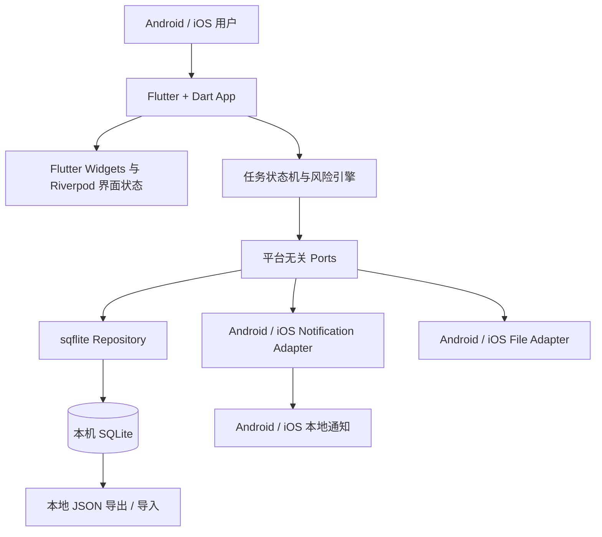

# DDL 生存指南技术方案

> 文档版本：1.5  
> 当前目标形态：Android 与 iOS 本地应用，Android 重点适配 OPPO、vivo  
> 远期目标形态：HarmonyOS，届时允许重写或重新选型  
> 数据方案：本机 SQLite，无云数据库  
> 技术选型状态：Flutter + Dart，须通过 Android/iOS 开工前技术 Spike  
> 对应 PRD：`docs/PRD.md`  
> 选型决策：`docs/TECH_STACK_DECISION.md`  
> 更新时间：2026-09-17

## 1. 技术结论

当前采用 Flutter + Dart 构建 Android 与 iOS 应用，Android 首批重点适配 OPPO ColorOS 与 vivo OriginOS。两端共用页面、领域逻辑、数据访问契约和大部分通知编排。所有任务、分类、设置、统计和历史事件保存在应用私有目录中的 SQLite 数据库，不建设账号系统、业务后端、云数据库或跨设备同步。

HarmonyOS 不属于当前工程范围，未来启动时允许使用 ArkTS + ArkUI 重写或选择届时更合适的方案。当前只要求任务状态机、风险算法、数据 Schema、导入导出协议、设计令牌和测试向量可迁移，不为鸿蒙提前引入运行时或插件约束。技术栈的完整比较见 `docs/TECH_STACK_DECISION.md`。

DDL 提醒采用 Android/iOS 本地通知：共享 Dart 层生成提醒计划，平台 Adapter 分别处理 Android 通知渠道、精确提醒和重启恢复，以及 iOS UserNotifications 授权与排程窗口。该流程不需要联网，也不依赖 OPPO PUSH、vivo Push、FCM、APNs 远程推送或应用持续驻留后台。

当前版本明确排除：

- HarmonyOS 工程实现；保留为远期独立评估项。
- PostgreSQL、MySQL 等云数据库。
- NestJS 等业务后端。
- Redis、消息队列和服务端提醒调度。
- 登录、账号和跨设备同步。
- OPPO PUSH、vivo Push、FCM 等远程推送。
- 云端 AI；自然语言能力仅考虑本地规则解析。

## 2. 技术目标

- 在 OPPO、vivo 主流 Android 设备和目标 iPhone 设备稳定运行。
- 应用完全离线时仍可创建、查看、完成任务并触发已排程提醒。
- SQLite 写入具备事务、约束、索引和可验证的版本迁移。
- 通知可显示在 Android/iOS 通知中心和锁屏，并在系统允许时显示横幅。
- 风险算法可解释、可测试，不依赖网络或模型服务。
- 应用升级不丢失数据；卸载或清除数据前明确提示并提供导出能力。
- 不把完整任务数据长期复制到 Riverpod 页面状态、SharedPreferences 或日志。
- 领域逻辑和本地数据协议不得直接绑定 Android 或 iOS；HarmonyOS 未来可复用契约和测试向量，但不要求复用当前 UI 代码。

## 3. 总体架构



数据流原则：

1. 页面通过 Use Case 调用领域逻辑。
2. 领域逻辑只依赖 `TaskRepository`、`NotificationPort`、`FilePort`、`ClockPort` 等接口。
3. Flutter Adapter 优先使用 `sqflite`、`flutter_local_notifications` 和文件插件；未覆盖能力通过 Kotlin/Swift Platform Channel 实现。
4. Repository 在 SQLite 事务中写入业务数据和任务事件。
5. 事务成功后，提醒排程器更新当前平台的本地通知。
6. 页面重新查询本地数据库，并把结果映射为响应式视图状态。

Android/iOS 版本中，SQLite 是任务数据的唯一权威来源。Riverpod 只保存当前筛选、页面会话和数据库查询结果，不承担永久存储职责。

## 4. 技术栈

### 4.1 共享应用层

- Flutter + Dart：任务领域模型、状态机、风险算法、页面与平台接口契约。
- Material 3 + 自有 Widget：作为可访问性基础，并按 Stitch 提取设计令牌、品牌组件和交互状态。
- `go_router`：页面导航、通知点击深链和路由守卫。
- `flutter_riverpod`：依赖注入、页面筛选、临时 UI 状态、权限状态和异步查询结果。
- Flutter `Form` + 自有 Validator：统一验证表单、JSON 导入文件和平台桥接参数。
- `intl` 与统一时间工具：封装 UTC、本地时区、倒计时、跨日和本地化格式。

### 4.2 数据与平台能力

- `sqflite` + `path`：Android/iOS SQLite、事务、索引和 Schema 升级。
- `flutter_local_notifications`：Android/iOS 本地通知排程、取消、点击事件和权限入口。
- `timezone`：按设备时区生成通知时间，处理跨日和夏令时。
- Kotlin Platform Channel：补齐 Android 通知渠道、AlarmManager、开机恢复、时间变化监听和厂商设置页跳转。
- Swift Platform Channel：补齐 iOS UserNotifications、系统设置跳转或插件未覆盖的生命周期能力。
- Android NotificationChannel：区分紧急提醒和普通提醒。
- Android AlarmManager：在确需准点提醒时使用精确提醒，并提供权限拒绝后的降级方案。
- iOS UserNotifications：处理授权、前台展示、锁屏隐私和待处理通知窗口。

### 4.3 质量工具

- `flutter analyze` + Dart formatter：静态检查与格式化。
- `flutter_test`：领域逻辑、Repository 契约、Validator 和 Widget 测试。
- `integration_test`：核心用户流程、数据库恢复和通知点击入口。
- Android Instrumentation / UI Automator 与 `adb`：数据库升级、锁屏通知、重启、Doze 和权限场景。
- XCTest / XCUITest：iOS 通知授权、锁屏展示、时间变化和应用升级场景。

## 5. 推荐目录结构

```text
DDL/
  lib/
    app/
    assets/
    core/
      validation/
      time/
      errors/
    data/
      database/
        connection.dart
        schema.dart
        migrations/
      repositories/
    domain/
      tasks/
      risk/
      reminders/
    platform/
      ports/
        task_repository.dart
        notification_port.dart
        file_port.dart
        clock_port.dart
      adapters/
        database/
        notifications/
        files/
    features/
      dashboard/
      tasks/
      confession/
      profile/
      data_management/
    routing/
    state/
    theme/
    widgets/
  android/
    app/
  ios/
    Runner/
  tests/
    unit/
    integration/
    e2e/
  docs/
    PRD.md
    TECHNICAL_SOLUTION.md
    HANDOFF.md
```

页面不得直接拼接 SQL。所有查询和写入必须经过 Repository，以便测试、迁移和未来替换实现。

## 6. SQLite 设计

### 6.1 连接生命周期

- 应用启动时创建单例 SQLite 连接并执行迁移。
- 进入前台时检查连接状态，异常时安全重连。
- 所有写入使用参数绑定，禁止字符串拼接用户输入。
- 多表写入必须使用事务。
- 数据库操作失败时回滚，并向界面返回稳定错误码。
- 只有应用生命周期层负责打开和关闭连接，页面不直接管理连接。

### 6.2 Schema 版本与迁移

- 使用连续整数作为数据库版本，例如 `1`、`2`、`3`。
- 每个版本提供前向迁移脚本和迁移后校验。
- 迁移必须幂等，或者在执行前检查当前版本。
- 生产数据库禁止通过“删除后重建”完成升级。
- 自动化测试至少覆盖从上一个正式版本升级到当前版本。
- 迁移失败时保留原数据库，记录不含任务正文的诊断信息，并阻止继续写入。

### 6.3 事务边界

以下操作必须在同一事务中完成：

- 创建任务与创建 `TASK_CREATED` 事件。
- 完成任务与创建 `TASK_COMPLETED` 事件。
- 进入忏悔录与创建 `TASK_OVERDUE` 事件。
- 确认错过或补记完成与对应事件。
- 删除任务与取消标记关联提醒。
- JSON 导入与导入版本记录。

系统通知不是 SQLite 事务的一部分。数据库事务成功后再排程通知；若通知排程失败，将 Reminder 标记为 `SCHEDULE_FAILED`，由启动或恢复前台时的协调任务重试。

### 6.4 索引策略

至少建立以下索引：

- 任务状态与截止时间：`tasks(status, due_at)`。
- 任务归档状态与更新时间：`tasks(archived_at, updated_at)`。
- 事件所属任务与发生时间：`task_events(task_id, occurred_at)`。
- 提醒所属任务与计划时间：`reminders(task_id, scheduled_at)`。
- 分类名称唯一索引，系统分类与自定义分类按业务规则区分。

MVP 数据量较小，不引入全文搜索。任务数量或备注规模达到真实瓶颈后，再评估 SQLite FTS。

## 7. 数据模型

### 7.1 `tasks`

- `id TEXT PRIMARY KEY`：UUID。
- `title TEXT NOT NULL`。
- `category_id TEXT NOT NULL`。
- `important INTEGER NOT NULL`：0 或 1。
- `due_at INTEGER NOT NULL`：UTC 毫秒时间戳。
- `estimated_minutes INTEGER NOT NULL`。
- `notes TEXT`。
- `status TEXT NOT NULL`。
- `completed_at INTEGER`。
- `archived_at INTEGER`。
- `risk_score_snapshot INTEGER`。
- `risk_config_version INTEGER NOT NULL`。
- `created_at INTEGER NOT NULL`。
- `updated_at INTEGER NOT NULL`。

状态值：`PENDING`、`COMPLETED`、`OVERDUE_REVIEW`、`COMPLETED_LATE`、`MISSED`、`ARCHIVED`。

### 7.2 `task_events`

- `id TEXT PRIMARY KEY`。
- `task_id TEXT NOT NULL`。
- `event_type TEXT NOT NULL`。
- `occurred_at INTEGER NOT NULL`。
- `metadata_json TEXT`：只保存必要结构化字段，不复制任务备注。

该表用于历史回顾、统计和问题恢复，不作为任务当前状态的替代品。

### 7.3 `categories`

- `id TEXT PRIMARY KEY`。
- `name TEXT NOT NULL`。
- `icon TEXT NOT NULL`。
- `color_token TEXT NOT NULL`。
- `is_system INTEGER NOT NULL`。
- `sort_order INTEGER NOT NULL`。
- `created_at INTEGER NOT NULL`。

### 7.4 `reminders`

- `id TEXT PRIMARY KEY`：平台无关 UUID。
- `platform_notification_id TEXT`：由各平台 Adapter 管理；Android Adapter 负责映射为系统要求的整数 ID。
- `task_id TEXT NOT NULL`。
- `scheduled_at INTEGER NOT NULL`。
- `channel TEXT NOT NULL`：`critical` 或 `normal`。
- `status TEXT NOT NULL`：`PENDING`、`SCHEDULED`、`SCHEDULE_FAILED`、`CANCELLED`、`FIRED`。
- `last_error_code TEXT`。
- `created_at INTEGER NOT NULL`。
- `updated_at INTEGER NOT NULL`。

### 7.5 `preferences`

单例配置记录：

- `copy_tone`：`off`、`gentle`、`standard`。
- `notifications_enabled`。
- `quiet_hours_start`、`quiet_hours_end`。
- `default_reminder_offsets_json`。
- `urgent_threshold_minutes`。
- `buffer_minutes`。
- `timezone`：IANA 时区。
- `updated_at`。

### 7.6 `profile`

单例本地资料：

- `nickname`。
- `motto`。
- `avatar_uri`，仅保存应用可持续访问的本地 URI。
- `created_at`、`updated_at`。

### 7.7 `app_meta`

- `key TEXT PRIMARY KEY`。
- `value TEXT NOT NULL`。

用于保存数据库迁移状态、风险配置版本、最近一次提醒协调时间和最近一次成功导出时间，不保存业务大对象。

## 8. Repository 接口

页面与领域层依赖接口而不是 SQLite 插件：

- `TaskRepository.create(input)`。
- `TaskRepository.update(id, patch)`。
- `TaskRepository.getById(id)`。
- `TaskRepository.list(query)`。
- `TaskRepository.transition(id, event)`。
- `TaskRepository.archive(id)`。
- `TaskRepository.delete(id)`。
- `TaskEventRepository.append(event)`。
- `ReminderRepository.replaceForTask(taskId, reminders)`。
- `PreferenceRepository.get()` / `save()`。
- `DataPort.export()` / `validateImport()` / `import()`。

Repository 返回领域对象，不把 SQLite 行格式泄露到页面。所有异常映射为稳定错误类型，例如 `DATABASE_UNAVAILABLE`、`VALIDATION_FAILED`、`MIGRATION_FAILED` 和 `STORAGE_FULL`。

## 9. 风险计算引擎

### 9.1 输入

- 当前时间。
- 截止时间。
- 预计耗时。
- 用户重要度。
- 缓冲时间和紧急阈值。
- SQLite 中指定窗口内其他未完成任务。
- 本地历史中同分类任务的错过率。

### 9.2 输出

- `urgent`。
- `quadrant`。
- `riskScore`：0 至 100。
- `riskLevel`。
- `reasons`：可解释原因代码和参数。
- `nextRecomputeAt`。

### 9.3 执行策略

- 风险算法实现为纯 Dart 函数，相同输入必须得到相同输出。
- 创建、编辑、状态流转、应用启动、恢复前台和时区变化时触发重算。
- 首页可见期间使用单一时钟源刷新倒计时，不为每张卡片创建定时器。
- 达到性能阈值后把批量计算迁移到 Dart Isolate，但后台任务不持有数据库连接。
- 风险分是可再生快照，算法升级时按原始任务重新生成。

## 10. Android/iOS 通知方案

### 10.1 本地排程

- 任务保存成功后，根据用户设置生成提醒计划并写入 `reminders`。
- 数据库事务成功后，通过 `NotificationPort` 排程；优先使用 `flutter_local_notifications`，插件缺口由 Kotlin/Swift Adapter 补齐。
- 任务完成、错过、归档、删除或修改截止时间时，取消旧通知后重新排程。
- 应用启动、恢复前台、设备重启或系统时间、时区变化后执行提醒协调；iOS 在每次启动和恢复前台时补充未来排程窗口。
- 协调过程以 SQLite 中的 Reminder 为期望状态，以当前平台待处理通知为实际状态，修复差异。

### 10.2 权限

- Android 13 及以上需要 `POST_NOTIFICATIONS`。
- 只有用户主动开启 DDL 提醒时才请求通知权限。
- Android 12 及以上如需准点提醒，先检查 `canScheduleExactAlarms()`。
- 精确提醒优先使用 `SCHEDULE_EXACT_ALARM` 并由用户授权；不默认使用受商店政策严格限制的 `USE_EXACT_ALARM`。
- 用户拒绝精确提醒后降级为非精确提醒，并在设置页说明可能存在时间浮动。
- iOS 在用户主动开启提醒后请求 UserNotifications 权限；拒绝后只提供系统设置入口，不重复弹窗。
- 应用不能绕过勿扰模式、锁屏隐私和用户关闭通知的选择。

### 10.3 Android 通知渠道

- `ddl_critical`：高重要性，用于临近截止时间的明确提醒，争取声音和顶部横幅。
- `ddl_normal`：默认重要性，用于提前一天等普通提醒。
- 用户可以在系统中修改渠道重要性；应用设置页应能跳转对应系统页面。
- 锁屏内容默认避免展示完整任务备注，只显示任务名称和剩余时间；用户可选择隐藏任务名称。

### 10.4 Android 边界

- 用户强行停止应用后，Android 可能阻止提醒和广播，直到用户再次打开应用。
- OPPO、vivo 的省电和后台策略因系统版本不同，必须真机验证。
- 顶部横幅不是应用可以强制保证的效果；它受通知渠道、系统版本、勿扰模式和用户设置控制。
- 精确提醒属于高影响能力，只有用户明确设定的 DDL 才应使用，避免滥用和耗电。

### 10.5 iOS 边界

- iOS 没有 Android NotificationChannel 与精确闹钟权限模型，必须使用 UserNotifications 的授权和展示规则。
- iOS 最多保留 64 个待处理本地通知；应用按触发时间排序后最多排程最近 60 个，并在启动、恢复前台和任务变更时取消过期项、滚动补充。
- 前台通知是否显示横幅和声音由应用委托策略与用户设置共同决定；锁屏内容受系统隐私设置控制。
- iOS 构建、签名、真机测试和上架必须使用 macOS、Xcode 与 Apple 开发者账号。

## 11. 时间处理

- SQLite 保存 UTC 毫秒时间戳；界面根据设备当前 IANA 时区显示。
- “今天、明天、本周五”以用户创建任务时的本地时区解释。
- 应用监听时间、日期和时区变化，并重新计算风险和提醒。
- 当前架构没有服务端时间校准，因此设备时间被手动修改会影响逾期判断；该限制必须在测试与帮助页中说明。
- 所有时间逻辑测试覆盖跨日、闰日、夏令时、时区切换和时间回拨。

## 12. 数据导出、导入与删除

由于没有云数据库，数据可恢复性必须由本地工具承担：

- P0 至少提供“导出全部数据”入口；P1 完成完整导入流程。
- 导出格式使用带 `formatVersion`、`exportedAt` 和校验信息的 JSON。
- 导入前使用统一 Dart Validator 检查文件结构、版本、枚举和时间字段。
- 导入先写入临时数据库或事务，校验成功后再替换现有数据。
- 导入模式明确区分“覆盖”和“合并”；MVP 优先只支持覆盖，降低冲突复杂度。
- 导出文件通过 Android 系统文件选择器或 iOS Share Sheet / Files 保存，不申请宽泛存储权限。
- 清除全部数据必须二次确认，并明确说明无法恢复。
- 应用卸载或系统清除数据会删除本机数据库；设置页应显示最近一次导出时间。
- 如严格要求“数据不上云”，应分别评估并关闭 Android Auto Backup 与 iCloud 应用数据备份，避免系统在用户不知情时上传数据库。

## 13. 数据安全

- SQLite 文件位于应用私有目录，其他普通应用不能直接访问。
- 数据库访问全部使用参数绑定和事务。
- 日志、崩溃报告和通知埋点不记录任务标题、备注或导出内容。
- 导出文件离开应用私有目录后由用户负责保管；导出页面应给出隐私提示。
- `sqflite` 默认不等同于 SQLCipher；若要求数据库加密，必须验证兼容的 SQLite 加密方案及 Android/iOS 迁移路径。
- 若启用数据库加密，密钥不得硬编码在 Dart、Kotlin、Swift 或应用资源中，应分别由 Android Keystore 与 iOS Keychain 保护。
- 未确定可靠的密钥恢复方案前，不以“加密”名义引入可能导致永久丢失的实现。

## 14. 性能与容量

- 中端 OPPO、vivo 设备冷启动可交互时间目标小于 2.5 秒。
- 目标最低 iOS 版本的主流 iPhone 冷启动可交互时间目标小于 2.5 秒。
- 首页查询只读取未来时间窗口内的必要字段，避免加载全部历史。
- 1000 条任务下首页风险重算目标小于 50ms；超出后启用 Dart Isolate。
- SQLite 写事务目标小于 100ms；耗时操作不得阻塞 Flutter UI Isolate。
- 任务列表采用分页或游标查询；达到真实瓶颈前不引入虚拟列表。
- 启动阶段只做必要迁移和提醒协调，历史统计延迟计算。

## 15. 测试策略

### 15.1 单元测试

- 任务状态机合法与非法流转。
- 风险分、象限和最晚开始时间。
- 日期快捷选项和时区转换。
- 提醒计划生成、取消和去重。
- JSON 导入校验和版本兼容。

### 15.2 SQLite 集成测试

- 首次建库和默认数据。
- CRUD、事务回滚和约束。
- 上一正式版本升级到当前版本。
- 存储空间不足和数据库连接恢复。
- 导出、覆盖导入与损坏文件拒绝。
- 任务状态与事件记录的原子性。

### 15.3 组件与流程测试

- 创建、编辑、完成、归档和删除任务。
- 四象限漂移与风险原因展示。
- 忏悔录两种处理分支。
- 数据导出和清除确认。
- 通知权限拒绝后的降级界面。

### 15.4 Android 真机测试

至少使用两台 OPPO 和两台 vivo，覆盖目标 ColorOS、OriginOS 与 Android 版本。验证：

1. 首次授权、拒绝和二次开启通知。
2. 锁屏、息屏和顶部横幅。
3. 应用在前台、后台和被系统回收后的提醒。
4. 设备重启后的提醒恢复。
5. 低电量模式、Doze 和厂商省电策略。
6. 精确提醒权限允许与拒绝。
7. 修改系统时间、时区和日期。
8. 应用升级后的 SQLite 迁移和提醒保留。
9. 用户强行停止后的限制说明和再次启动修复。

### 15.5 iOS 真机测试

至少覆盖一台接近最低目标版本和一台当前主流版本的 iPhone。验证：

1. 首次通知授权、拒绝、系统设置重新开启。
2. 前台、后台、终止状态与锁屏展示。
3. 待处理通知窗口滚动补充，避免超过系统数量限制。
4. 修改系统时间、时区和日期。
5. 应用升级后的 SQLite 迁移和提醒保留。
6. JSON 导出到 Files、分享和重新导入。

## 16. 诊断与可观测性

当前不建设云端日志平台。应用提供本地诊断能力：

- 记录应用版本、数据库版本、最近迁移结果和最近提醒协调结果。
- 错误日志只保存错误码、模块和时间，不保存任务正文。
- 设置页提供“导出诊断信息”，与业务数据导出分离。
- 日志采用大小上限和滚动清理，避免无限增长。
- 若未来接入崩溃上报服务，必须单独获得用户授权并更新隐私政策。

## 17. 构建与发布

- Flutter 工具链从同一 Dart 工程构建 Android APK / AAB 与 iOS IPA / Archive。
- Android 使用固定 applicationId 与受控签名；iOS 使用固定 Bundle ID、证书和 Provisioning Profile。
- 签名文件和密码不得进入工程目录或交接文档。
- 每次发布递增 Android `versionCode`、iOS build number，并同步更新可见版本号。
- 发布前执行数据库迁移测试、真机通知 Smoke Test 和导出恢复测试。
- 当前无服务端部署、数据库运维或远程配置依赖。
- 风险参数和默认文案随应用版本发布，记录配置版本以支持迁移。

## 18. 分阶段实现

### 阶段 A：工程与数据底座

- Flutter、Dart、Android 与 iOS 构建底座。
- SQLite 连接、Schema、迁移和 Repository。
- 任务状态机、风险算法和单元测试。
- 设计令牌、基础布局和底部导航。

### 阶段 B：核心产品闭环

- 首页、四象限、创建、任务详情、忏悔录和个人中心。
- 本地统计、设置和数据清除。
- Android/iOS 本地通知、权限引导和通知点击路由。

### 阶段 C：可靠性与发布

- Android 开机恢复、双端时间变化处理和提醒协调。
- JSON 导出、导入和诊断信息。
- OPPO、vivo 与 iPhone 真机矩阵测试。
- 性能、可访问性和发布包检查。

### 阶段 D：本地增强

- 重复任务、日历视图和归档历史。
- 本地自然语言规则解析。
- 基于本机历史的提醒策略。

任何云端 AI、账号同步或远程推送需求都需要重新立项并更新架构，不直接在当前 SQLite 单机方案上偷偷增加云依赖。

## 19. 关键技术决策

- 选择 Flutter：当前目标是 Android/iOS，Flutter 官方支持双端，可共享 UI 和业务逻辑，并通过 Platform Channel 补齐系统能力。
- 选择 `sqflite` / SQLite 而非 Web 存储：事务、索引、迁移和原生持久性更适合核心任务数据；通过 Repository 隔离插件。
- 选择本地通知而非厂商推送：DDL 由用户在本机创建，本地排程无需网络、后端或厂商账号。
- 选择无账号单机模式：降低开发和运维成本，但明确放弃跨设备同步和云恢复。
- 选择规则引擎而非云端 AI：结果可解释、离线可用且没有 API 密钥泄露问题。
- 选择 Repository 隔离插件：页面不依赖具体 SQLite API，便于测试和处理插件升级。
- 选择手动导出而非隐式云备份：让“数据不上云”的边界清晰可见。

## 20. 开工前技术 Spike

建议先用 3 至 5 个工作日验证；这是正式工程初始化的准入门槛：

- 同一 Flutter 工程的 Android/iOS 构建、调试、签名和发布链；iOS 使用 macOS、Xcode 和真机。
- 在 OPPO、vivo 与 iPhone 真机上复现 390px 首页关键组件、底部导航、表单、键盘和安全区。
- `sqflite` 在 Android/iOS 上的数据库位置、事务、迁移、备份策略和性能。
- 建库、事务、升级迁移、JSON 导出和覆盖导入。
- 1000 条任务查询与风险计算性能。
- `flutter_local_notifications` 在 Android/iOS 的锁屏、前台、后台和终止状态表现。
- Android 13 通知权限与 Android 14 及以上精确提醒权限流程。
- 设备重启、时间变化和应用升级后的提醒重建。
- iOS 通知授权、待处理通知窗口、Files 导出和通知点击路由。
- 是否启用 SQLCipher，以及密钥丢失和应用升级的恢复策略。

具体通过条件和回退触发项见 `docs/TECH_STACK_DECISION.md`。

## 21. 平台实现与远期策略

### 21.1 共享资产

Android 与 iOS 直接复用或保持一致的内容：

- 产品需求、页面信息架构和设计令牌。
- Dart 任务状态机、风险算法和同一组测试向量。
- 任务、事件、分类、提醒和设置的逻辑 Schema。
- 带版本号的 JSON 导入导出协议。
- 通知文案、风险原因代码和可访问性要求。
- Repository、Notification、File、Clock 等平台接口的行为契约。

### 21.2 iOS

- 复用 Flutter 页面、Dart 领域层、设计令牌、Repository 和接口契约。
- 本地存储使用 `sqflite`，独立验证数据库位置、iCloud 备份策略和加密行为。
- 本地通知由 `flutter_local_notifications` 对接 UserNotifications；不能复用 Android 通知渠道、精确闹钟权限和通知 ID 假设。
- iOS 的通知授权、锁屏隐私、待处理通知数量、文件导出、签名和 App Store 规则必须独立测试。

### 21.3 HarmonyOS

- 当前不创建工程，也不要求 Flutter 与现有插件兼容 HarmonyOS。
- 真正立项时重新比较 Flutter/OpenHarmony 适配、ArkTS + ArkUI 重写和其他方案。
- 允许重写 UI、存储与通知层，优先复用产品规则、设计令牌、逻辑 Schema、JSON 协议和测试向量。
- 不假设 Android APK、iOS IPA、SQLite 文件或平台通知 ID 可以直接迁移到 HarmonyOS。

### 21.4 数据迁移

- 用户跨平台迁移优先通过版本化 JSON 导出和导入完成，不依赖复制数据库文件。
- 导入协议只包含业务字段，不暴露平台通知 ID、数据库内部主键策略或原生文件路径。
- 新平台导入后重新生成风险快照和本地通知，不直接迁移原平台通知排程。

## 22. 实施约束

- 未经用户明确允许，不执行任何 Git 命令，不创建仓库、分支、提交或标签。
- 每次完成有意义的开发阶段都必须更新 `docs/HANDOFF.md`。
- Flutter Android/iOS Spike 通过后才初始化正式工程，并锁定 Flutter SDK、Dart SDK 与插件版本。
- 改变 SQLite Schema、任务状态机、通知权限或目标系统范围前，先更新本文档并说明原因。
- 不得为了方便调试引入未披露的云数据库、远程日志或用户行为采集。

## 23. 官方参考

- 技术栈选型决策：`docs/TECH_STACK_DECISION.md`
- Flutter 官方支持平台：https://docs.flutter.dev/reference/supported-platforms
- Flutter 平台通道：https://docs.flutter.dev/platform-integration/platform-channels
- Flutter SQLite 实践：https://docs.flutter.dev/cookbook/persistence/sqlite
- Flutter iOS 开发环境：https://docs.flutter.dev/platform-integration/ios/setup
- Flutter Local Notifications：https://pub.dev/packages/flutter_local_notifications
- Android 通知概览：https://developer.android.com/develop/ui/compose/notifications
- Android 闹钟与精确提醒：https://developer.android.com/develop/background-work/services/alarms
- Android 14 精确提醒权限变化：https://developer.android.com/about/versions/14/changes/schedule-exact-alarms
- Apple UserNotifications：https://developer.apple.com/documentation/usernotifications
